<div align="center">

# Sistema de Selección de Practicantes

**Reto técnico del Programa de Practicantes del Banco de Bogotá**

*Monolito modular con Spring Modulith, API REST nivel 3 (HATEOAS) y cliente web hipermedia*

**Autora:** Ana Gabriela Fiquitiva<br/>
Estudiante de Ingeniería de Sistemas, 9.º semestre<br/>
Escuela Colombiana de Ingeniería Julio Garavito

[](https://github.com/AnaFiquitiva/kata-practicing/actions)
[](https://sonarcloud.io/summary/overall?id=AnaFiquitiva_kata-practicing)
[](https://sonarcloud.io/summary/overall?id=AnaFiquitiva_kata-practicing)
[](https://sonarcloud.io/summary/overall?id=AnaFiquitiva_kata-practicing)


-14327D)


</div>

---

## Tabla de contenido

1. [Resumen](#1-resumen)
2. [Objetivos](#2-objetivos)
3. [Tecnologías: back-end y front-end](#3-tecnologías-back-end-y-front-end)
4. [Arquitectura](#4-arquitectura)
5. [Patrones de diseño](#5-patrones-de-diseño)
6. [Integridad de datos](#6-integridad-de-datos)
7. [Seguridad](#7-seguridad)
8. [Calidad y pruebas](#8-calidad-y-pruebas)
9. [Evidencias](#9-evidencias)
10. [Instalación y ejecución](#10-instalación-y-ejecución)
11. [Referencia de la API REST](#11-referencia-de-la-api-rest)
12. [Estructura del proyecto](#12-estructura-del-proyecto)
13. [Cumplimiento del reto](#13-cumplimiento-del-reto)
14. [Identidad visual y fuentes](#14-identidad-visual-y-fuentes)
15. [Referencias](#15-referencias)

---

## 1. Resumen

Este proyecto es una aplicación web con dos usuarios:

- **Practicante (público):** llena un formulario con sus datos y adjunta su hoja de vida en PDF.
- **Analista de selección (con usuario y contraseña):** revisa a los postulados y marca a cada uno como **Viable** o **No viable**.

El **back-end** es un **monolito modular**: una sola aplicación Spring Boot dividida en módulos de negocio con fronteras que se **verifican automáticamente** en cada build. Expone una **API REST de nivel 3** (HATEOAS): cada respuesta trae los enlaces de las acciones permitidas, y el **front-end** (HTML, CSS y JavaScript sin frameworks) los sigue en vez de escribir las URLs a mano.

| Indicador | Resultado | Evidencia |
|---|---|---|
| Pruebas automatizadas | **98**, todas en verde | [Evidencia E8](#e8-github-actions), [`PracticanteApiTest`](backend/src/test/java/com/bdb/katapracticing/PracticanteApiTest.java) |
| Cobertura (JaCoCo) | **99 %** de instrucciones, **96 %** de ramas (mínimo exigido: 90 %) | [Evidencia E10](#e10-jacoco) |
| Calidad (SonarCloud) | Quality Gate **aprobado**, 0 bugs, 0 vulnerabilidades, 0 % de duplicación | [Evidencia E9](#e9-sonarcloud) |
| Fronteras de la arquitectura | Verificadas por [`ModulosTest`](backend/src/test/java/com/bdb/katapracticing/ModulosTest.java#L26) | [Sección 4.2](#42-estilo-arquitectónico-monolito-modular) |
| Madurez REST | **Nivel 3** de Richardson (HAL + HAL-FORMS) | [Sección 4.4](#44-estilo-de-la-api-rest-nivel-3-hateoas), [Evidencia E2](#e2-video-prueba-de-los-endpoints-en-swagger-ui) |

---

## 2. Objetivos

**Objetivo general.** Construir una herramienta web que permita registrar practicantes y apoyar la decisión del analista de selección, con una arquitectura mantenible, segura y verificable.

**Objetivos específicos.**

1. Diseñar el back-end como un **monolito modular** cuyas fronteras entre módulos se comprueben con pruebas automáticas.
2. Aplicar **patrones de diseño** solo donde resuelvan un problema concreto, y documentar el porqué.
3. Exponer una **API REST de nivel 3** con controles hipermedia (HAL y HAL-FORMS), documentada con **OpenAPI 3 / Swagger**.
4. Garantizar la **integridad de los datos** en varias capas: navegador, API, dominio y base de datos, incluida la concurrencia entre analistas.
5. Asegurar la calidad con **pruebas**, **cobertura mínima obligatoria** e **integración continua** con SonarCloud.

---

## 3. Tecnologías: back-end y front-end

### Back-end (`backend/`)

| Tecnología | Versión | Para qué se usó |
|---|---|---|
| Java | 21 | Lenguaje: `record`, `switch` con flechas, *text blocks* |
| Spring Boot (Web) | 3.3 | Controladores REST, *multipart* para subir archivos |
| **Spring Modulith** | 1.2 | Define los módulos y **verifica sus fronteras** en las pruebas |
| **Spring HATEOAS** | 2.3 | Enlaces HAL (`_links`) y plantillas HAL-FORMS (`_templates`) |
| Spring Data JPA con Hibernate | 6.5 | Persistencia, repositorios, `@Version` (bloqueo optimista) |
| Jakarta Validation | 3 | `@NotBlank`, `@Email`, `@Min`, `@Max` en la entrada |
| Spring Security | 6.3 | Login por API, sesión `HttpOnly`, CSRF, BCrypt |
| springdoc-openapi | 2.6 | Contrato OpenAPI 3 y Swagger UI |
| Jackson | 2.17 | Convierte los objetos Java a **JSON** y viceversa (JSON es el formato; Jackson es la librería) |
| SQLite | 3.46 | Base de datos local en un archivo |
| JUnit 5, Mockito, AssertJ y MockMvc | — | Pruebas unitarias, de integración y de arquitectura |
| JaCoCo | 0.8.12 | Cobertura; `mvn verify` falla si baja del 90 % |
| Maven | 3.9 | Construcción y dependencias |

### Front-end (`frontend/`)

| Tecnología | Para qué se usó |
|---|---|
| HTML5 semántico | `header`, `main`, `section`, `aside`, `form`, `dl`, `table` y atributos `aria-*` |
| CSS3 | Variables CSS (*custom properties*) con la paleta del banco, **Grid** y **Flexbox**, 4 *breakpoints* *responsive* |
| JavaScript ES2022 (sin frameworks) | `fetch`, `async/await`, *optional chaining* (`?.`), clases, desestructuración |
| Montserrat (Google Fonts) | Tipografía, sustituto de la corporativa |
| Nginx 1.27 | Sirve los archivos estáticos y hace de **proxy inverso** hacia la API |

### Infraestructura y calidad

| Herramienta | Para qué se usó |
|---|---|
| Docker y Docker Compose | Dos contenedores (UI y API) y volúmenes persistentes |
| Dockerfile *multi-stage* | Compila con JDK 21 y ejecuta con JRE 21 Alpine, con un usuario sin privilegios |
| GitHub Actions | Ejecuta pruebas y cobertura y envía el análisis en cada *push* |
| SonarCloud | Análisis estático de Java, HTML, CSS y JS, con Quality Gate |

---

## 4. Arquitectura

### 4.1 Vista general: ejecución local

El proyecto **se ejecuta en local**, en el equipo del desarrollador o del evaluador, con Docker Compose. No se despliega en la nube ni en un servidor. Docker solo empaqueta las dos partes (front y back) para que arranquen igual en cualquier máquina con un solo comando.

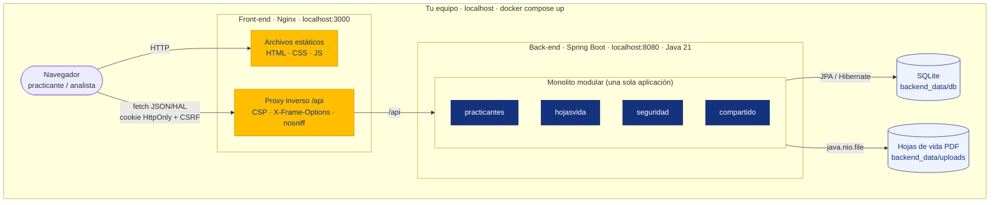

- **Front-end:** Nginx sirve las páginas y funciona como **proxy inverso**. El navegador ve el front y la API en el **mismo origen** (`localhost:3000`), así que no hace falta CORS y la cookie de sesión puede ser `HttpOnly`.
- **Back-end:** un **único proceso** Java que contiene los cuatro módulos del monolito. Su organización interna se explica en la sección siguiente.
- **Datos:** la base SQLite y los PDF se guardan en carpetas del propio equipo (`backend_data/`), por lo que no se pierden al apagar los contenedores.

### 4.2 Estilo arquitectónico: monolito modular

Un **monolito modular** es **una sola aplicación** (un solo proceso que se ejecuta y se entrega como una unidad) dividida por **áreas de negocio**, no por capas técnicas. Cada módulo es como una "caja negra": publica una API pequeña y esconde el resto. [Spring Modulith](https://spring.io/projects/spring-modulith) permite declarar los módulos y **comprobar con una prueba** que nadie se salte las reglas.

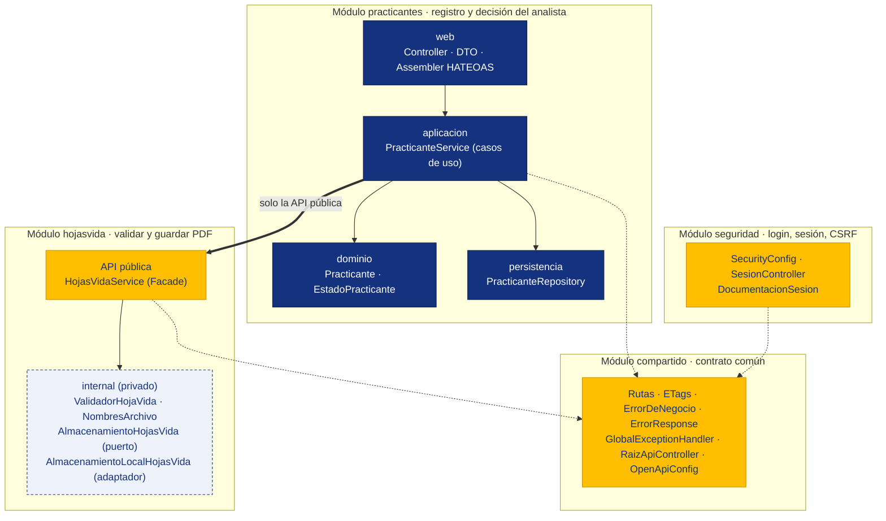

**Cómo leer el diagrama:** en **amarillo**, la API pública de cada módulo; en **azul**, las capas internas de `practicantes`; con borde punteado, lo privado (`internal`). La flecha gruesa es la única dependencia entre módulos de negocio (`practicantes` usa la fachada de `hojasvida`); las punteadas son dependencias hacia el contrato común.

| Módulo | Responsabilidad | API pública | Puede depender de |
|---|---|---|---|
| [`practicantes`](backend/src/main/java/com/bdb/katapracticing/practicantes/package-info.java#L8) | Registrar practicantes y decidir Viable / No viable | — (nadie la necesita) | `compartido`, `hojasvida` |
| [`hojasvida`](backend/src/main/java/com/bdb/katapracticing/hojasvida/package-info.java#L7) | Validar, guardar y entregar los PDF | `HojasVidaService`, `HojaVidaGuardada`, `HojaVidaDescargable`, `ArchivoInvalidoException` | `compartido` |
| [`seguridad`](backend/src/main/java/com/bdb/katapracticing/seguridad/package-info.java#L5) | Autenticación del analista y reglas de acceso | — | `compartido` |
| [`compartido`](backend/src/main/java/com/bdb/katapracticing/compartido/package-info.java#L5) | Contrato común: rutas, errores, ETags y raíz de la API | `Rutas`, `ETags`, `ErrorResponse`, `ErrorDeNegocio`, `TipoError`, entre otras | nada |

**Reglas, verificadas en cada `mvn test`:**

1. Lo que está en la **raíz** del paquete del módulo es **público**; lo que está en **subpaquetes** es **interno**.
2. Cada módulo **declara** de quién puede depender (`allowedDependencies`).
3. No hay **ciclos** entre módulos.

```java
// practicantes/package-info.java — declaración del módulo y sus dependencias permitidas
@ApplicationModule(displayName = "Practicantes", allowedDependencies = {"compartido", "hojasvida"})
package com.bdb.katapracticing.practicantes;
```

```java
// test/.../ModulosTest.java — prueba de arquitectura: falla si alguien rompe una frontera
@Test
void lasFronterasEntreModulosSeRespetan() {
    assertThatCode(modulos::verify).doesNotThrowAnyException();
}
```

Si alguien rompe una frontera, la prueba falla con un mensaje como este:

```
Module 'seguridad' depends on module 'hojasvida' via ...seguridad.X -> ...hojasvida.internal.ValidadorHojaVida.
Allowed targets: compartido.
```

> **En palabras simples:** el monolito modular es como un edificio de apartamentos. Todos comparten la estructura (una sola aplicación), pero cada apartamento tiene su puerta con llave (su API pública), y una prueba automática revisa que nadie entre por la ventana.

> **¿Por qué no microservicios?** Un monolito modular da la misma separación de responsabilidades sin los costos de la red: no hay latencia entre servicios, no hay transacciones distribuidas y se ejecuta una sola aplicación. Si un módulo crece (por ejemplo, `hojasvida` con almacenamiento en la nube y antivirus), ya tiene una frontera limpia para convertirlo en servicio.

#### Arquitectura en capas dentro de cada módulo

El monolito modular corta el sistema en **vertical**, por áreas de negocio. Dentro del módulo principal, `practicantes`, el código se corta además en **horizontal**, por **capas**. Las dos decisiones se complementan: los módulos separan *qué* hace el sistema y las capas separan *cómo* se atiende cada petición.

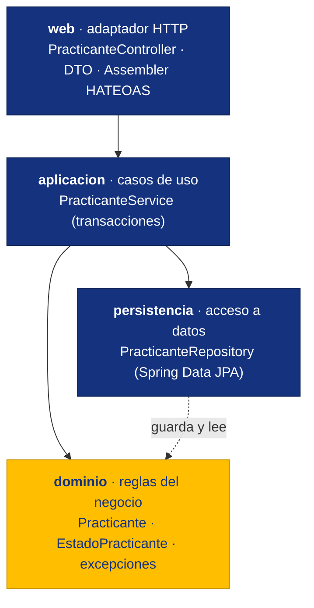

| Capa | Responsabilidad | No debe | Código |
|---|---|---|---|
| `web` | Traducir entre HTTP y el caso de uso: validar la entrada, armar la respuesta HAL y los códigos HTTP | contener reglas de negocio | [`PracticanteController`](backend/src/main/java/com/bdb/katapracticing/practicantes/web/PracticanteController.java#L167) |
| `aplicacion` | Orquestar cada caso de uso (registrar, listar, decidir) dentro de una transacción | conocer HTTP ni JSON | [`PracticanteService`](backend/src/main/java/com/bdb/katapracticing/practicantes/aplicacion/PracticanteService.java#L73) |
| `dominio` | Proteger las reglas: semestre 1–10, correo normalizado, transiciones de estado | depender de Spring Web ni de la base de datos | [`Practicante`](backend/src/main/java/com/bdb/katapracticing/practicantes/dominio/Practicante.java#L93) |
| `persistencia` | Guardar y consultar practicantes | decidir reglas | [`PracticanteRepository`](backend/src/main/java/com/bdb/katapracticing/practicantes/persistencia/PracticanteRepository.java#L9) |

**Regla de dependencia:** cada capa solo llama a la de abajo; nunca al revés. Por ejemplo, el controlador no decide nada, solo traduce la petición a un caso de uso:

```java
// practicantes/web/PracticanteController.java — capa web: solo traduce HTTP ⇄ caso de uso
@PatchMapping(path = "/{id}/estado", consumes = MediaType.APPLICATION_JSON_VALUE)
public ResponseEntity<EntityModel<PracticanteResponse>> actualizarEstado(
        @PathVariable Long id,
        @RequestHeader(value = HttpHeaders.IF_MATCH, required = false) String ifMatch,
        @Valid @RequestBody ActualizarEstadoRequest cuerpo) {
    Practicante actualizado = servicio.actualizarEstado(id, cuerpo.getEstado(), ETags.versionDe(ifMatch));
    return ResponseEntity.ok()
            .eTag(ETags.de(actualizado.getVersion()))
            .body(ensamblador.toModel(actualizado));
}
```

La capa de aplicación tampoco recibe objetos de la web. La web convierte su DTO a un tipo propio del caso de uso:

```java
// practicantes/web/RegistroPracticanteRequest.java
public DatosRegistro comoDatosRegistro() {
    return new DatosRegistro(nombreCompleto, correo, carrera, semestre);
}
```

Los módulos más pequeños no necesitan las cuatro capas: `hojasvida` solo separa su **API pública** (`HojasVidaService`) de lo **interno** (`internal/`), y `seguridad` y `compartido` son configuración y contrato común.

> **En palabras simples:** el mesero (web) toma el pedido, el administrador (aplicación) lo organiza, el chef (dominio) decide cómo se prepara y la despensa (persistencia) guarda los ingredientes. Ninguno hace el trabajo del otro.

### 4.3 Arquitectura del front-end

El front-end no usa frameworks. Cada página tiene su propio script, y todos comparten las utilidades de `comun.js`. Solo [`analista.js`](frontend/js/analista.js#L92) navega la API siguiendo enlaces HATEOAS; [`registro.js`](frontend/js/registro.js) y [`login.js`](frontend/js/login.js) llaman directamente a sus endpoints.

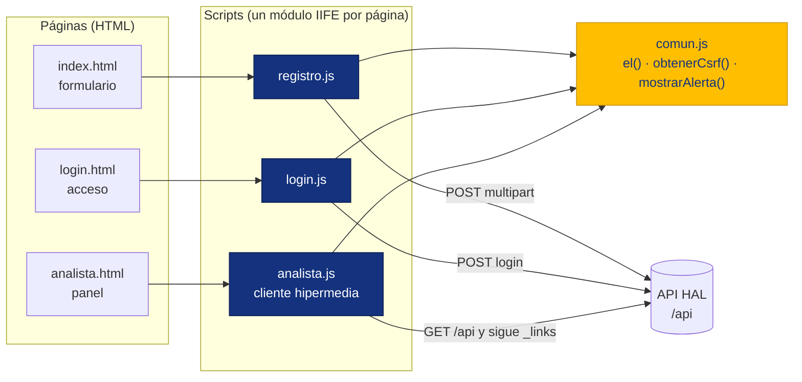

### 4.4 Estilo de la API: REST nivel 3 (HATEOAS)

El [modelo de madurez de Richardson](https://martinfowler.com/articles/richardsonMaturityModel.html) mide qué tan "REST" es una API. Esta cumple los cuatro niveles:

| Nivel | Qué exige | Cómo se cumple aquí |
|---|---|---|
| 0 | Usar HTTP como transporte | Todo viaja por HTTP con JSON |
| 1 | Recursos con su propia URL | `/api/practicantes`, `/api/practicantes/{id}`, `/api/practicantes/{id}/hoja-vida` |
| 2 | Verbos y códigos HTTP correctos | `GET` / `POST` / `PATCH`; `201`, `304`, `400`, `401`, `403`, `404`, `405`, `409`, `412`, `413`, `415` |
| **3** | **Controles hipermedia** | **HAL** (`_links`) y **HAL-FORMS** (`_templates`) |

Un practicante `PENDIENTE` solo ofrece las acciones que el dominio permite desde ese estado:

```json
GET /api/practicantes/7
{
  "id": 7, "nombreCompleto": "Ana Pérez", "semestre": 8, "estado": "PENDIENTE", "version": 0,
  "_links": {
    "self":             { "href": "http://localhost:3000/api/practicantes/7" },
    "hoja-vida":        { "href": ".../api/practicantes/7/hoja-vida", "type": "application/pdf", "title": "cv.pdf" },
    "collection":       { "href": ".../api/practicantes{?estado}", "templated": true },
    "marcar-viable":    { "href": ".../api/practicantes/7/estado", "name": "VIABLE",    "title": "Marcar como viable" },
    "marcar-no-viable": { "href": ".../api/practicantes/7/estado", "name": "NO_VIABLE", "title": "Marcar como no viable" }
  }
}
```

- **Punto de entrada único:** `GET /api` (público) devuelve enlaces a todo: `practicantes`, `registrar-practicante`, `csrf`, `login`, `logout`, `usuario-actual`, `service-desc` (OpenAPI) y `service-doc` (Swagger UI).
- **Colecciones navegables:** la lista es paginada (máximo 100 por página) y trae `first`, `prev`, `next` y `last`.
- **HAL-FORMS:** con `Accept: application/prs.hal-forms+json`, el recurso además describe cómo ejecutar la acción: método `PATCH`, `contentType`, campos y valores posibles.

### 4.5 Ciclo de vida de un practicante

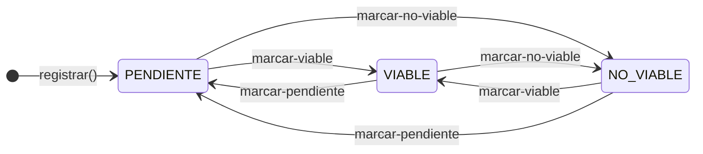

Cada flecha es un **enlace** que la API publica solo cuando la transición es válida. Pedir el estado que ya tiene (por ejemplo, `VIABLE → VIABLE`) devuelve `409 Conflict`.

### 4.6 Flujo de una decisión del analista

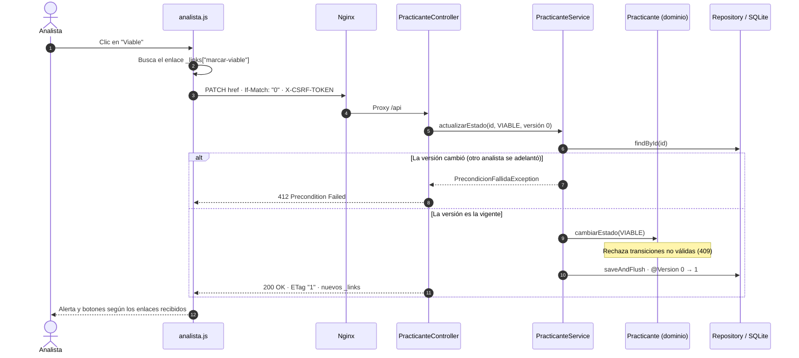

---

## 5. Patrones de diseño

> **La arquitectura no es un patrón de diseño.** El **monolito modular** y la **arquitectura en capas** no aparecen en esta lista porque no son patrones de diseño: son decisiones de **arquitectura**, las de más alto nivel sobre cómo se organiza y se ejecuta la aplicación (ver [Sección 4.2](#42-estilo-arquitectónico-monolito-modular) y [capas](#arquitectura-en-capas-dentro-de-cada-módulo)). Los patrones de esta sección son soluciones más pequeñas que se aplican **dentro** de esa arquitectura, en una clase, un módulo o una capa.

Solo se aplicó un patrón cuando resolvía un problema real del proyecto. Cada uno se presenta así: **problema → solución → implementación (con el código real y su enlace) → beneficio**, y al final una explicación en palabras simples.

### 5.1 Resumen

| # | Patrón | Tipo | Capa | Dónde (enlace al código) |
|---|---|---|---|---|
| [P1](#p1-facade-fachada) | Facade (fachada) | GoF, estructural | Back | [`HojasVidaService`](backend/src/main/java/com/bdb/katapracticing/hojasvida/HojasVidaService.java#L33) |
| [P2](#p2-puertos-y-adaptadores-adapter) | Puertos y adaptadores (Adapter) | GoF, estructural / hexagonal | Back | [`AlmacenamientoHojasVida`](backend/src/main/java/com/bdb/katapracticing/hojasvida/internal/AlmacenamientoHojasVida.java#L13) |
| [P3](#p3-repository) | Repository | DDD / PoEAA | Back | [`PracticanteRepository`](backend/src/main/java/com/bdb/katapracticing/practicantes/persistencia/PracticanteRepository.java#L9) |
| [P4](#p4-dto-data-transfer-object) | DTO | PoEAA | Back | [`PracticanteResponse`](backend/src/main/java/com/bdb/katapracticing/practicantes/web/PracticanteResponse.java#L16) |
| [P5](#p5-assembler-hateoas) | Assembler (HATEOAS) | PoEAA / REST | Back | [`PracticanteModelAssembler`](backend/src/main/java/com/bdb/katapracticing/practicantes/web/PracticanteModelAssembler.java#L30) |
| [P6](#p6-método-de-fábrica--modelo-de-dominio-rico) | Método de fábrica + dominio rico | GoF creacional, GRASP | Back | [`Practicante.registrar`](backend/src/main/java/com/bdb/katapracticing/practicantes/dominio/Practicante.java#L93) |
| [P7](#p7-máquina-de-estados-en-el-enum) | Máquina de estados en el enum | Comportamiento | Back | [`EstadoPracticante`](backend/src/main/java/com/bdb/katapracticing/practicantes/dominio/EstadoPracticante.java#L16) |
| [P8](#p8-bloqueo-optimista--peticiones-condicionales-etag) | Bloqueo optimista + ETag | PoEAA (concurrencia) | Back | [`@Version`](backend/src/main/java/com/bdb/katapracticing/practicantes/dominio/Practicante.java#L73), [`ETags`](backend/src/main/java/com/bdb/katapracticing/compartido/ETags.java#L25) |
| [P9](#p9-inyección-de-dependencias) | Inyección de dependencias | IoC / SOLID (D) | Back | [`PracticanteService`](backend/src/main/java/com/bdb/katapracticing/practicantes/aplicacion/PracticanteService.java#L26) |
| [P10](#p10-jerarquía-de-errores--manejador-centralizado) | Jerarquía de errores + manejador central | SOLID (O) | Back | [`ErrorDeNegocio`](backend/src/main/java/com/bdb/katapracticing/compartido/ErrorDeNegocio.java#L10), [`GlobalExceptionHandler`](backend/src/main/java/com/bdb/katapracticing/compartido/web/GlobalExceptionHandler.java#L44) |
| [P11](#p11-patrón-módulo-iife) | Patrón Módulo (IIFE) | JavaScript | Front | [`registro.js`](frontend/js/registro.js), [`analista.js`](frontend/js/analista.js) |
| [P12](#p12-cliente-hipermedia) | Cliente hipermedia | REST | Front | [`analista.js#cargar`](frontend/js/analista.js#L92) |
| [P13](#p13-estado-único--renderizado) | Estado único + renderizado | Front-end | Front | [`analista.js#renderTabla`](frontend/js/analista.js#L46) |
| [P14](#p14-delegación-de-eventos) | Delegación de eventos | DOM | Front | [`analista.js`](frontend/js/analista.js#L140) |
| [P15](#p15-fábrica-segura-de-nodos-dom) | Fábrica segura de nodos DOM | Creacional / seguridad | Front | [`comun.js#el`](frontend/js/comun.js#L11) |
| [P16](#p16-proxy-inverso-gateway) | Proxy inverso (Gateway) | Infraestructura | Infra | [`default.conf.template`](frontend/nginx/default.conf.template#L26) |

### 5.2 Patrones del back-end

#### P1. Facade (fachada)

- **Problema:** guardar una hoja de vida requiere tres pasos internos (validar que sea un PDF real, guardarla y limpiar su nombre). Si `practicantes` coordinara esos pasos, conocería los detalles internos de otro módulo.
- **Solución:** una sola clase pública que ofrece operaciones simples y esconde el resto.
- **Implementación:** [`HojasVidaService.guardar`](backend/src/main/java/com/bdb/katapracticing/hojasvida/HojasVidaService.java#L33).

```java
// hojasvida/HojasVidaService.java — la única puerta de entrada al módulo
public HojaVidaGuardada guardar(MultipartFile archivo) {
    validador.validar(archivo);                                        // hojasvida.internal
    try (InputStream contenido = archivo.getInputStream()) {
        String identificador = almacenamiento.guardar(contenido);      // hojasvida.internal
        return new HojaVidaGuardada(identificador, NombresArchivo.paraMostrar(archivo.getOriginalFilename()));
    } catch (IOException e) {
        throw new UncheckedIOException("No se pudo leer la hoja de vida", e);
    }
}
```

```java
// practicantes/aplicacion/PracticanteService.java — el otro módulo hace UNA sola llamada
HojaVidaGuardada hojaVida = hojasVida.guardar(archivo);
```

- **Beneficio:** `practicantes` no se entera de cómo se valida ni dónde se guarda el PDF, y Spring Modulith le **impide** usar las clases de `internal`.

> **En palabras simples:** es la recepción de un hotel. Pides "una habitación" y no necesitas hablar con limpieza, mantenimiento y reservas por separado.

#### P2. Puertos y adaptadores (Adapter)

- **Problema:** hoy los PDF se guardan en una carpeta local, pero en un banco lo normal es guardarlos en la nube (S3, Azure Blob).
- **Solución:** la fachada depende de una **interfaz** (el *puerto*) y no de la carpeta (el *adaptador*). Aplica el **principio de inversión de dependencias** (la D de SOLID).
- **Implementación:** [puerto](backend/src/main/java/com/bdb/katapracticing/hojasvida/internal/AlmacenamientoHojasVida.java#L13) y [adaptador](backend/src/main/java/com/bdb/katapracticing/hojasvida/internal/AlmacenamientoLocalHojasVida.java#L38).

```java
// hojasvida/internal/AlmacenamientoHojasVida.java — el PUERTO: qué se necesita
public interface AlmacenamientoHojasVida {
    String guardar(InputStream contenido);
    Resource cargar(String identificador);
    void eliminar(String identificador);
}
```

```java
// hojasvida/internal/AlmacenamientoLocalHojasVida.java — el ADAPTADOR: cómo se hace hoy
@Override
public String guardar(InputStream contenido) {
    String identificador = UUID.randomUUID() + EXTENSION;     // nombre UUID: sin colisiones ni path traversal
    try {
        Files.copy(contenido, directorio.resolve(identificador));
    } catch (IOException e) {
        throw new UncheckedIOException("No se pudo guardar la hoja de vida", e);
    }
    return identificador;
}
```

- **Beneficio:** pasar a la nube es escribir otro adaptador, sin tocar la fachada ni el módulo `practicantes`.

> **En palabras simples:** el puerto es el enchufe de la pared; el adaptador es el cargador. Cambias de cargador sin cambiar la pared.

#### P3. Repository

- **Problema:** el servicio no debería escribir SQL ni saber que la base es SQLite.
- **Solución:** una interfaz que se comporta como una "colección" de practicantes. Spring Data genera la implementación a partir del nombre de cada método.
- **Implementación:** [`PracticanteRepository`](backend/src/main/java/com/bdb/katapracticing/practicantes/persistencia/PracticanteRepository.java#L9).

```java
// practicantes/persistencia/PracticanteRepository.java
public interface PracticanteRepository extends JpaRepository<Practicante, Long> {
    boolean existsByCorreoIgnoreCase(String correo);
    Page<Practicante> findByEstado(EstadoPracticante estado, Pageable pagina);
}
```

- **Beneficio:** cambiar de base de datos (por ejemplo, a PostgreSQL) no afecta la lógica de negocio.

> **En palabras simples:** le pides a la biblioteca "los libros de este autor" sin saber en qué estante están.

#### P4. DTO (Data Transfer Object)

- **Problema:** la entidad guarda datos internos, como el nombre del archivo en disco (`hojaVidaArchivo`, un UUID). Devolver la entidad directamente los expondría.
- **Solución:** un objeto que lleva **solo** lo que el cliente debe ver.
- **Implementación:** [`PracticanteResponse`](backend/src/main/java/com/bdb/katapracticing/practicantes/web/PracticanteResponse.java#L16) (salida) y [`RegistroPracticanteRequest`](backend/src/main/java/com/bdb/katapracticing/practicantes/web/RegistroPracticanteRequest.java) (entrada, con las validaciones).

```java
// practicantes/web/PracticanteResponse.java — nunca expone la ruta interna del archivo
@Relation(itemRelation = "practicante", collectionRelation = "practicantes")
public record PracticanteResponse(
        Long id, String nombreCompleto, String correo, String carrera, Integer semestre,
        String hojaVidaNombre, EstadoPracticante estado,
        LocalDateTime fechaRegistro, LocalDateTime fechaActualizacionEstado,
        long version) { ... }
```

- **Beneficio:** la API y la base de datos pueden cambiar por separado.

> **En palabras simples:** es el recibo que te entregan en la tienda. No es el inventario completo, solo lo que te interesa.

#### P5. Assembler (HATEOAS)

- **Problema:** para llegar al nivel 3 de REST, cada respuesta debe traer los enlaces de las acciones disponibles, y esos enlaces dependen del estado del practicante.
- **Solución:** una clase que **ensambla** la representación: datos (DTO) más enlaces calculados.
- **Implementación:** [`PracticanteModelAssembler.toModel`](backend/src/main/java/com/bdb/katapracticing/practicantes/web/PracticanteModelAssembler.java#L30), con las relaciones definidas en [`RelacionesPracticante`](backend/src/main/java/com/bdb/katapracticing/practicantes/web/RelacionesPracticante.java), HAL-FORMS activado en [`HipermediaConfig`](backend/src/main/java/com/bdb/katapracticing/practicantes/web/HipermediaConfig.java#L17) y la raíz en [`RaizApiController`](backend/src/main/java/com/bdb/katapracticing/compartido/web/RaizApiController.java#L25).

```java
// practicantes/web/PracticanteModelAssembler.java — datos + controles hipermedia según el estado
EntityModel<PracticanteResponse> modelo = EntityModel.of(PracticanteResponse.desde(practicante), self);
modelo.add(linkTo(api.descargarHojaVida(id)).withRel(RelacionesPracticante.HOJA_VIDA)
        .withType(MediaType.APPLICATION_PDF_VALUE)
        .withTitle(practicante.getHojaVidaNombreOriginal()));
modelo.add(linkTo(api.listar(null, null)).withRel(IanaLinkRelations.COLLECTION));

for (EstadoPracticante destino : transiciones) {
    // name = valor que el cliente debe enviar en {"estado": ...} al seguir el enlace con PATCH.
    modelo.add(linkTo(api.actualizarEstado(id, null, null))
            .withRel(RelacionesPracticante.marcar(destino))       // marcar-viable, marcar-no-viable…
            .withName(destino.name())
            .withTitle(RelacionesPracticante.titulo(destino)));
}
```

- **Beneficio:** el cliente no necesita conocer las reglas ni las URLs; las descubre.

> **En palabras simples:** es como un cajero automático que solo te muestra los botones de las operaciones que puedes hacer con tu tarjeta.

#### P6. Método de fábrica + modelo de dominio rico

- **Problema:** con *setters* públicos, cualquier parte del código podía crear un practicante sin estado, con semestre 12 o cambiar el estado sin registrar la fecha.
- **Solución:** la entidad **protege sus propias reglas** (patrón GRASP *Experto en información*): se crea solo con un método de fábrica y no tiene *setters*.
- **Implementación:** [`Practicante.registrar`](backend/src/main/java/com/bdb/katapracticing/practicantes/dominio/Practicante.java#L93) y [`cambiarEstado`](backend/src/main/java/com/bdb/katapracticing/practicantes/dominio/Practicante.java#L120).

```java
// practicantes/dominio/Practicante.java
public static Practicante registrar(String nombreCompleto, String correo, String carrera, int semestre,
                                    String hojaVidaNombreOriginal, String hojaVidaArchivo) {
    return new Practicante(
            Objects.requireNonNull(nombreCompleto, "nombreCompleto").trim(),
            normalizarCorreo(correo),                              // minúsculas y sin espacios
            Objects.requireNonNull(carrera, "carrera").trim(),
            validarSemestre(semestre),                             // 1..10; si no, SemestreFueraDeRangoException
            Objects.requireNonNull(hojaVidaNombreOriginal, "hojaVidaNombreOriginal"),
            Objects.requireNonNull(hojaVidaArchivo, "hojaVidaArchivo"));   // nace en PENDIENTE
}

public void cambiarEstado(EstadoPracticante nuevoEstado) {
    Objects.requireNonNull(nuevoEstado, "El estado es obligatorio");
    if (!estado.puedeCambiarA(nuevoEstado)) {
        throw new TransicionDeEstadoInvalidaException(estado, nuevoEstado);   // → 409
    }
    this.estado = nuevoEstado;
    this.fechaActualizacionEstado = LocalDateTime.now();   // estado y fecha cambian siempre juntos
}
```

- **Beneficio:** es **imposible** tener un practicante inválido en memoria, venga de donde venga la orden.

> **En palabras simples:** la entidad es como un formulario oficial con casillas bloqueadas. Solo se llena por el camino correcto.

#### P7. Máquina de estados en el enum

- **Problema:** ¿quién decide a qué estados se puede pasar? Si fuera el controlador o el front, la regla quedaría repetida en varios lugares.
- **Solución:** cada valor del `enum` sabe a qué estados puede pasar. Es una máquina de estados sencilla: no hace falta el patrón *State* completo porque los estados no tienen comportamiento distinto.
- **Implementación:** [`EstadoPracticante.transicionesPermitidas`](backend/src/main/java/com/bdb/katapracticing/practicantes/dominio/EstadoPracticante.java#L16).

```java
// practicantes/dominio/EstadoPracticante.java
public enum EstadoPracticante {
    PENDIENTE, VIABLE, NO_VIABLE;

    /** Un practicante puede pasar a cualquier otro estado, pero no "cambiar" al que ya tiene. */
    public Set<EstadoPracticante> transicionesPermitidas() {
        return EnumSet.complementOf(EnumSet.of(this));
    }

    public boolean puedeCambiarA(EstadoPracticante destino) {
        return destino != null && transicionesPermitidas().contains(destino);
    }
}
```

- **Beneficio:** una sola fuente de verdad. El dominio la aplica (P6), el *Assembler* la publica como enlaces (P5) y el front habilita los botones según esos enlaces (P12).

#### P8. Bloqueo optimista + peticiones condicionales (ETag)

- **Problema:** dos analistas abren al mismo practicante; uno lo marca **Viable** y, segundos después, el otro lo marca **No viable** sin haber visto el cambio. La primera decisión se perdería (*lost update*).
- **Solución:** cada registro tiene una **versión**. La API la publica como `ETag`, y el cliente la devuelve en `If-Match`. Si no coincide, se rechaza la escritura.
- **Implementación:** [`@Version`](backend/src/main/java/com/bdb/katapracticing/practicantes/dominio/Practicante.java#L73) en la entidad, [`ETags.versionDe`](backend/src/main/java/com/bdb/katapracticing/compartido/ETags.java#L25) y la verificación en [`PracticanteService.actualizarEstado`](backend/src/main/java/com/bdb/katapracticing/practicantes/aplicacion/PracticanteService.java#L73).

```java
// practicantes/dominio/Practicante.java — JPA incrementa la versión en cada cambio
@Version
@Column(nullable = false, columnDefinition = "INTEGER DEFAULT 0 NOT NULL")
private long version;
```

```java
// practicantes/aplicacion/PracticanteService.java
@Transactional
public Practicante actualizarEstado(Long id, EstadoPracticante estado, Long versionEsperada) {
    Practicante practicante = obtener(id);
    if (versionEsperada != null && !practicante.tieneVersion(versionEsperada)) {
        throw new PrecondicionFallidaException();          // If-Match desactualizado → 412
    }
    practicante.cambiarEstado(estado);
    return repositorio.saveAndFlush(practicante);          // @Version detecta escrituras simultáneas → 409
}
```

- **Beneficio:** no hay actualizaciones perdidas y no se bloquea a nadie mientras lee. Además, `If-None-Match` permite responder `304 Not Modified`.

> **En palabras simples:** es como editar un documento compartido que te avisa: "alguien lo cambió mientras lo leías, recarga antes de guardar".

#### P9. Inyección de dependencias

- **Problema:** si una clase crea lo que necesita (con `new`), no se puede reemplazar por un doble de prueba.
- **Solución:** las dependencias llegan por el **constructor**. Spring las conecta en producción y las pruebas pasan *mocks*.
- **Implementación:** [constructor de `PracticanteService`](backend/src/main/java/com/bdb/katapracticing/practicantes/aplicacion/PracticanteService.java#L26) y [la prueba que lo aprovecha](backend/src/test/java/com/bdb/katapracticing/practicantes/aplicacion/PracticanteServiceTest.java#L96).

```java
// practicantes/aplicacion/PracticanteService.java
public PracticanteService(PracticanteRepository repositorio, HojasVidaService hojasVida) {
    this.repositorio = repositorio;
    this.hojasVida = hojasVida;
}
```

```java
// test/.../PracticanteServiceTest.java — el módulo hojasvida se reemplaza por un mock
@Test
void registrar_falloInesperadoEnBd_eliminaArchivoYPropagaElError() {
    when(hojasVida.guardar(pdf)).thenReturn(GUARDADA);
    when(repositorio.saveAndFlush(any(Practicante.class))).thenThrow(new IllegalStateException("BD caída"));

    assertThatThrownBy(() -> servicio.registrar(datos, pdf)).isInstanceOf(IllegalStateException.class);
    verify(hojasVida).eliminar(ARCHIVO_INTERNO);   // no quedan archivos huérfanos
}
```

- **Beneficio:** pruebas rápidas y aisladas, sin disco ni base de datos.

#### P10. Jerarquía de errores + manejador centralizado

- **Problema:** si el manejador global conociera las excepciones de cada módulo, `compartido` dependería de todos (un ciclo que la prueba de arquitectura rechaza). Además, cada error nuevo obligaría a modificarlo.
- **Solución:** una excepción base en `compartido`. Cada módulo la extiende y el manejador solo conoce la base. Esto aplica el **principio abierto/cerrado** (la O de SOLID). El negocio no conoce códigos HTTP: dice qué *tipo* de error es y la web lo traduce.
- **Implementación:** [`ErrorDeNegocio`](backend/src/main/java/com/bdb/katapracticing/compartido/ErrorDeNegocio.java#L10), [`CorreoDuplicadoException`](backend/src/main/java/com/bdb/katapracticing/practicantes/dominio/CorreoDuplicadoException.java#L6) y [`GlobalExceptionHandler`](backend/src/main/java/com/bdb/katapracticing/compartido/web/GlobalExceptionHandler.java#L44).

```java
// compartido/ErrorDeNegocio.java — la base que conocen todos
public abstract class ErrorDeNegocio extends RuntimeException {
    private final TipoError tipo;      // DATO_INVALIDO, CONFLICTO, NO_ENCONTRADO, PRECONDICION_FALLIDA
    private final String campo;        // campo del formulario a marcar (opcional)
}

// practicantes/dominio/CorreoDuplicadoException.java — cada módulo define los suyos
public class CorreoDuplicadoException extends ErrorDeNegocio {
    public CorreoDuplicadoException() { super(TipoError.CONFLICTO, CAMPO, MENSAJE); }
}
```

```java
// compartido/web/GlobalExceptionHandler.java — un solo método para todos los errores de negocio
@ExceptionHandler(ErrorDeNegocio.class)
public ResponseEntity<ErrorResponse> errorDeNegocio(ErrorDeNegocio ex) {
    HttpStatus estado = estadoHttp(ex.getTipo());
    ErrorResponse error = ex.getCampo()
            .map(campo -> ErrorResponse.deCampo(estado, campo, ex.getMessage()))
            .orElseGet(() -> ErrorResponse.de(estado, ex.getMessage()));
    return responder(error);
}

static HttpStatus estadoHttp(TipoError tipo) {
    return switch (tipo) {
        case DATO_INVALIDO -> HttpStatus.BAD_REQUEST;
        case CONFLICTO -> HttpStatus.CONFLICT;
        case NO_ENCONTRADO -> HttpStatus.NOT_FOUND;
        case PRECONDICION_FALLIDA -> HttpStatus.PRECONDITION_FAILED;
    };
}
```

- **Beneficio:** todos los errores, incluidos 404, 405, 415 y el login fallido, salen con el **mismo formato** y sin exponer trazas internas:

```json
{ "estado": 409, "mensaje": "Ya existe un registro con este correo electrónico",
  "errores": { "correo": "Ya existe un registro con este correo electrónico" }, "fecha": "..." }
```

### 5.3 Patrones del front-end

#### P11. Patrón Módulo (IIFE)

- **Problema:** en JavaScript sin *bundler*, las variables declaradas en un script quedan globales y pueden chocar entre páginas.
- **Solución:** envolver cada script en una **función que se ejecuta de inmediato** (IIFE, *Immediately Invoked Function Expression*). Lo de adentro es privado.
- **Implementación:** [`registro.js`](frontend/js/registro.js), [`login.js`](frontend/js/login.js) y [`analista.js`](frontend/js/analista.js).

```js
// frontend/js/registro.js — todo queda privado dentro del módulo
(() => {
  const form = document.getElementById("form-registro");
  const SEMESTRE_MAXIMO = 10; // mismo límite que valida la API (Practicante.SEMESTRE_MAXIMO)
  // ...
})();

// frontend/js/analista.js — versión asíncrona; "void" indica que la promesa se ignora a propósito
void (async () => { /* ... */ })();
```

#### P12. Cliente hipermedia

- **Problema:** si el front escribe las URLs y las reglas a mano (`/api/practicantes/${id}/estado`, "deshabilitar si ya es VIABLE"), cualquier cambio en la API rompe el front.
- **Solución:** el front **parte de `GET /api`** y **sigue los enlaces**: recorre las páginas con `next`, habilita un botón solo si existe su enlace y hace el `PATCH` al `href` recibido.
- **Implementación:** [`enlace`](frontend/js/analista.js#L32), [`cargar`](frontend/js/analista.js#L92) y [`cambiarEstado`](frontend/js/analista.js#L107).

```js
// frontend/js/analista.js
const enlace = (recurso, rel) => recurso?._links?.[rel];
const REL_ACCION = { PENDIENTE: "marcar-pendiente", VIABLE: "marcar-viable", NO_VIABLE: "marcar-no-viable" };

/** Descubre la colección desde la raíz de la API y recorre todas las páginas siguiendo el enlace "next". */
async function cargar() {
  const raiz = await api("/api");
  let url = enlace(raiz, "practicantes").href.replace(/\{\?[^}]*\}$/, "") + "?size=100";
  const todos = [];
  while (url) {
    const pagina = await api(url);
    todos.push(...(pagina._embedded?.practicantes ?? []));
    url = enlace(pagina, "next")?.href;
  }
  estado.practicantes = todos;
  // ...
}

// Un botón solo se habilita si la API ofrece el enlace de esa transición para el estado actual.
document.querySelectorAll("[data-accion]").forEach(b => (b.disabled = !enlace(p, REL_ACCION[b.dataset.accion])));

// El PATCH va al href del enlace, con la versión para la concurrencia optimista (P8).
const actualizado = await api(accion.href, {
  method: "PATCH",
  headers: { "Content-Type": "application/json", "If-Match": `"${actual.version}"`,
             [estado.csrf.headerName]: estado.csrf.token },
  body: JSON.stringify({ estado: accion.name }),
});
```

> **En palabras simples:** en vez de memorizar el mapa, el front lee las señales del camino que le pone la API.

#### P13. Estado único + renderizado

- **Problema:** si cada evento modifica el DOM a mano, la tabla, el detalle y los totales terminan mostrando datos distintos.
- **Solución:** un **único objeto de estado** y funciones que **redibujan** la vista a partir de él (la misma idea que usan React o Vue, sin el framework).
- **Implementación:** [`analista.js`](frontend/js/analista.js#L46).

```js
// frontend/js/analista.js
const estado = { practicantes: [], filtro: "", busqueda: "", seleccionado: null, csrf: null };

function renderTabla() {
  const q = estado.busqueda.toLowerCase();
  const visibles = estado.practicantes.filter(p =>
    (!estado.filtro || p.estado === estado.filtro) &&
    (!q || [p.nombreCompleto, p.correo, p.carrera].some(v => v.toLowerCase().includes(q))));
  cuerpoTabla.replaceChildren(...visibles.map(p => el("tr", { /* ... */ })));
}
```

#### P14. Delegación de eventos

- **Problema:** registrar un *listener* por cada botón de filtro es repetitivo.
- **Solución:** un solo *listener* en el contenedor, que identifica el botón pulsado con `closest()`.
- **Implementación:** [`analista.js`](frontend/js/analista.js#L140).

```js
// frontend/js/analista.js
$("filtros").addEventListener("click", (e) => {
  const b = e.target.closest(".filtro");
  if (!b) return;
  document.querySelectorAll(".filtro").forEach(f => f.classList.toggle("activo", f === b));
  estado.filtro = b.dataset.estado;
  renderTabla();
});
```

#### P15. Fábrica segura de nodos DOM

- **Problema:** construir HTML con `innerHTML` y datos del usuario (por ejemplo, un nombre como ``) abre la puerta a ataques **XSS**.
- **Solución:** una pequeña fábrica que crea elementos y pone el texto con `createTextNode`, de modo que **nunca** se interpreta como HTML.
- **Implementación:** [`comun.js#el`](frontend/js/comun.js#L11).

```js
// frontend/js/comun.js
/** Crea un elemento DOM de forma segura (sin innerHTML → sin XSS). */
function el(tag, attrs = {}, ...hijos) {
  const nodo = document.createElement(tag);
  for (const [k, v] of Object.entries(attrs)) {
    if (k === "class") nodo.className = v;
    else if (k.startsWith("on")) nodo.addEventListener(k.slice(2), v);
    else nodo.setAttribute(k, v);
  }
  for (const h of hijos.flat()) {
    if (h == null) continue;
    nodo.append(h instanceof Node ? h : document.createTextNode(String(h)));
  }
  return nodo;
}
```

### 5.4 Patrón de infraestructura

#### P16. Proxy inverso (Gateway)

- **Problema:** si el navegador llamara directamente a `:8080`, habría que abrir CORS y la cookie de sesión no podría ser tan restrictiva.
- **Solución:** Nginx sirve el front y **reenvía** `/api` al back-end, agregando cabeceras de seguridad.
- **Implementación:** [`default.conf.template`](frontend/nginx/default.conf.template#L26).

```nginx
# frontend/nginx/default.conf.template
location /api {
    proxy_pass ${BACKEND_URL};
    proxy_set_header Host $http_host;
    proxy_set_header X-Forwarded-Proto $scheme;
    proxy_set_header X-Forwarded-Port $puerto_publico;   # enlaces HATEOAS absolutos correctos
    proxy_hide_header X-Frame-Options;                   # evita cabeceras duplicadas con Spring Security
    proxy_hide_header X-Content-Type-Options;
}
```

### 5.5 Principios SOLID y GRASP aplicados

| Principio | Dónde se ve |
|---|---|
| **S**: Responsabilidad única | En `hojasvida` cada clase tiene un solo motivo para cambiar: `ValidadorHojaVida` (reglas del PDF), `NombresArchivo` (nombre a mostrar), `AlmacenamientoLocalHojasVida` (disco) y `HojasVidaService` (coordinar) |
| **O**: Abierto/cerrado | Una excepción nueva extiende `ErrorDeNegocio` sin tocar el manejador (P10) |
| **L**: Sustitución de Liskov | Cualquier implementación de `AlmacenamientoHojasVida` sirve a la fachada (P2) |
| **I**: Segregación de interfaces | El puerto de almacenamiento expone solo `guardar`, `cargar` y `eliminar` |
| **D**: Inversión de dependencias | La fachada depende de la interfaz, no del disco (P2); las dependencias se inyectan (P9) |
| GRASP: Experto en información | `Practicante` valida su semestre y sus transiciones (P6, P7) |
| GRASP: Bajo acoplamiento | Los módulos se comunican solo por su API pública (ver la [sección 4.2](#42-estilo-arquitectónico-monolito-modular) y el patrón [P1. Facade](#p1-facade-fachada)) |

### 5.6 Patrones que aporta el framework y alternativas descartadas

| Patrón (aportado por Spring) | Dónde aparece |
|---|---|
| Front Controller | `DispatcherServlet` recibe todas las peticiones y las reparte |
| Chain of Responsibility | [`SecurityFilterChain`](backend/src/main/java/com/bdb/katapracticing/seguridad/SecurityConfig.java#L46): filtros de CSRF, sesión y autorización |
| Strategy | `PasswordEncoder` (BCrypt) y los manejadores de login exitoso o fallido |
| Proxy | `@Transactional` y los repositorios de Spring Data |
| Unit of Work | JPA guarda los cambios al cerrar la transacción |
| Builder | `ResponseEntity.ok().eTag(...).body(...)`, `ContentDisposition.attachment()...build()` |

| Alternativa descartada | Por qué no se usó |
|---|---|
| Microservicios (alternativa de **arquitectura**, no de patrón) | Agregan red, varios procesos que coordinar y transacciones distribuidas sin un beneficio real para este tamaño |
| Eventos entre módulos | Hoy ningún módulo reacciona a un registro. Con notificaciones por correo, `practicantes` publicaría `PracticanteRegistrado` |
| *State* (GoF) completo | Los estados no tienen comportamiento distinto; basta la máquina de estados del enum (P7) |
| Chain of Responsibility para validar el PDF | Son tres reglas fijas; una cadena sería ceremonia sin beneficio |

---

## 6. Integridad de datos

Cada regla se valida en **varias capas**: si una falla, la siguiente la detiene.

| Regla | Navegador | API (Jakarta Validation) | Dominio | Base de datos |
|---|---|---|---|---|
| Semestre entre 1 y 10 | El `<select>` solo ofrece 1–10 | `@Min(1)` `@Max(10)` → `400` | `SemestreFueraDeRangoException` | `CHECK (semestre BETWEEN 1 AND 10)`\* |
| Correo único | — | Consulta previa → `409` | Se normaliza (minúsculas, sin espacios) | `UNIQUE` (decide en registros simultáneos → `409`) |
| Obligatorios y longitudes | `required`, `maxlength` | `@NotBlank`, `@Size(max = 120)` | `Objects.requireNonNull` | `NOT NULL`, `length = 120` |
| Transición de estado válida | Botón deshabilitado si no hay enlace | — | `TransicionDeEstadoInvalidaException` → `409` | `CHECK` del enum\* |
| Sin actualizaciones perdidas | Envía `If-Match` | `If-Match` desactualizado → `412` | `@Version` → `409` | Columna `version` |
| Archivo PDF real | Extensión `.pdf` y máximo 5 MB | Máximo 5 MB, si no → `413` | Firma `%PDF-` en `ValidadorHojaVida` | Nombre UUID; si falla la BD, se borra el archivo |

\* Hibernate crea las restricciones `CHECK` cuando crea la tabla (pruebas y bases nuevas); `ddl-auto=update` no las agrega a tablas existentes. En ese caso, la regla la garantizan la API y el dominio. Para producción se recomienda versionar el esquema con Flyway o Liquibase.

**Otras buenas prácticas de la API:** `201 Created` con `Location` y `ETag`; paginación con máximo 100 y orden solo por campos permitidos; `PATCH` solo con `application/json` (`415`); `405` con cabecera `Allow`; transacciones por caso de uso (lecturas con `readOnly = true`); un único formato de error.

---

## 7. Seguridad

| Amenaza | Medida | Dónde |
|---|---|---|
| Acceso no autorizado al panel | Spring Security: rol `ANALISTA`, contraseña con **BCrypt**, `401` sin sesión | [`SecurityConfig`](backend/src/main/java/com/bdb/katapracticing/seguridad/SecurityConfig.java#L46) |
| Robo de sesión por JavaScript | Cookie `JSESSIONID` **HttpOnly**, mismo origen gracias al proxy | [patrón P16](#p16-proxy-inverso-gateway) |
| CSRF | Token obligatorio en `POST`/`PATCH`/logout (`X-CSRF-TOKEN`) | `GET /api/csrf` |
| XSS | DOM con `textContent` (nunca `innerHTML`) y **Content Security Policy** estricta | [patrón P15](#p15-fábrica-segura-de-nodos-dom), [`nginx`](frontend/nginx/default.conf.template#L23) |
| *Clickjacking* y *MIME sniffing* | `X-Frame-Options: DENY`, `X-Content-Type-Options: nosniff` | Nginx |
| *Path traversal* al guardar archivos | Nombres **UUID**; la ruta se resuelve dentro de la carpeta | [`AlmacenamientoLocalHojasVida`](backend/src/main/java/com/bdb/katapracticing/hojasvida/internal/AlmacenamientoLocalHojasVida.java#L38) |
| Archivos maliciosos con extensión `.pdf` | Se comprueba la firma `%PDF-` | [`ValidadorHojaVida`](backend/src/main/java/com/bdb/katapracticing/hojasvida/internal/ValidadorHojaVida.java#L41) |
| ReDoS en la validación del correo | Validación sin expresión regular | [`registro.js`](frontend/js/registro.js#L13) |
| Contenedor comprometido | La API corre con el usuario `app` (UID 1000), no como `root` | [`Dockerfile`](backend/Dockerfile#L13) |

---

## 8. Calidad y pruebas

```bash
cd backend
mvn verify      # pruebas + cobertura; falla si la cobertura baja del 90 %
```

| Tipo | Clase | Qué comprueba |
|---|---|---|
| **Arquitectura** | [`ModulosTest`](backend/src/test/java/com/bdb/katapracticing/ModulosTest.java) | Fronteras entre módulos, ausencia de ciclos y dependencias permitidas; genera diagramas PlantUML |
| Integración (API completa) | [`PracticanteApiTest`](backend/src/test/java/com/bdb/katapracticing/PracticanteApiTest.java) | Flujo completo; semestre 10 sí y 11 no; seguridad (401, CSRF); **HATEOAS** (raíz, enlaces por estado, HAL-FORMS, paginación); **integridad** (409, 412, 304); 400/404/405/415; contrato OpenAPI |
| Unitaria (servicio) | [`PracticanteServiceTest`](backend/src/test/java/com/bdb/katapracticing/practicantes/aplicacion/PracticanteServiceTest.java) | Registro, correo duplicado (también en carrera), limpieza de archivos huérfanos, versión, filtros |
| Unitaria (dominio) | [`PracticanteTest`](backend/src/test/java/com/bdb/katapracticing/practicantes/dominio/PracticanteTest.java) | Normalización, semestre fuera de rango (0, 11, 12), transiciones, versión |
| Unitaria (concurrencia) | [`ETagsTest`](backend/src/test/java/com/bdb/katapracticing/compartido/ETagsTest.java) | `If-Match` fuerte, débil, comodín y ausente |
| Unitaria (errores HTTP) | [`GlobalExceptionHandlerTest`](backend/src/test/java/com/bdb/katapracticing/compartido/web/GlobalExceptionHandlerTest.java) | 413 configurable; código HTTP de cada tipo de error; mensajes de 404/405/415 |
| Módulo `hojasvida` | [`HojasVidaServiceTest`](backend/src/test/java/com/bdb/katapracticing/hojasvida/HojasVidaServiceTest.java) y pruebas de `internal` | Reglas del PDF, nombres, *path traversal*, fallos de disco |

- **Integración continua:** [`.github/workflows/sonarcloud.yml`](.github/workflows/sonarcloud.yml) ejecuta `mvn verify` y envía el análisis a SonarCloud en cada *push* y *pull request*. La configuración está en [`sonar-project.properties`](sonar-project.properties).
- **Build sin advertencias:** el agente de Mockito/Byte Buddy se carga con `-javaagent` ([`pom.xml`](backend/pom.xml#L160)), no dinámicamente, algo que el JDK 21 advierte. El único `WARN` del log es intencional: la prueba de *path traversal* con `../secreto.txt`.
- **Hallazgos corregidos del primer análisis de SonarCloud:** promesas sin manejar en `analista.js` y `login.js`, una expresión regular con riesgo de ReDoS en `registro.js` y el contenedor que corría como `root`.
- **Hallazgo corregido al agregar HATEOAS:** SonarCloud detectó un posible *request forgery* (reglas `S5144` y `S8476`) porque el panel seguía los enlaces de la API sin validarlos. Ahora [`rutaDeLaApi`](frontend/js/analista.js) solo permite enlaces del mismo origen bajo `/api`, y el Quality Gate volvió a quedar en **Passed** (commit `43a5d16`).

---

## 9. Evidencias

Índice de todas las evidencias del proyecto, organizadas por tipo. Cada fila enlaza a la evidencia y explica qué demuestra.

| # | Evidencia | Qué demuestra | Enlace |
|---|---|---|---|
| E1 | Video: cómo funciona la aplicación | Flujo completo del practicante y del analista | [Ver](#e1-video-cómo-funciona-la-aplicación), [MP4](docs/videos/demo-aplicacion.mp4) |
| E2 | Video: prueba de los endpoints | REST nivel 3, ETag/If-Match (412), transición inválida (409), semestre 11 (400) | [Ver](#e2-video-prueba-de-los-endpoints-en-swagger-ui), [MP4](docs/videos/demo-endpoints.mp4) |
| E3 | Formulario de registro | Front del practicante (semestres 1–10) | [Ver](#e3-formulario-de-registro-y-e4-login) |
| E4 | Inicio de sesión | Acceso del analista | [Ver](#e3-formulario-de-registro-y-e4-login) |
| E5 | Panel del analista | Totales, búsqueda, filtros y detalle | [Ver](#e5-panel-del-analista) |
| E6 | Decisión: Viable / No viable | Botones habilitados según los enlaces HATEOAS | [Ver](#e6-decisión-del-analista-viable--no-viable) |
| E7 | Swagger UI | Contrato OpenAPI 3 documentado | [Ver](#e7-swagger-ui), `http://localhost:3000/api/docs/swagger-ui.html` |
| E8 | GitHub Actions | Pipeline de CI en verde | [Ver](#e8-github-actions), [Actions](https://github.com/AnaFiquitiva/kata-practicing/actions) |
| E9 | SonarCloud | Quality Gate aprobado, 0 incidencias | [Ver](#e9-sonarcloud), [Proyecto](https://sonarcloud.io/summary/overall?id=AnaFiquitiva_kata-practicing) |
| E10 | JaCoCo | 99 % de instrucciones, 96 % de ramas | [Ver](#e10-jacoco) |
| E11 | Identidad visual | Uso de logos y colores oficiales | [Ver](#e11-identidad-visual) |
| E12 | Prueba de arquitectura | Las fronteras del monolito modular se cumplen | [`ModulosTest`](backend/src/test/java/com/bdb/katapracticing/ModulosTest.java#L26) |

### Funcionamiento (front-end)

#### E1. Video: cómo funciona la aplicación

Duración: 1 min 38 s, sin audio, con subtítulos. Muestra la validación del formulario, el registro con PDF, el correo repetido (`409`), el login fallido y correcto, la búsqueda, los filtros, las decisiones **Viable** y **No viable** y el cierre de sesión. Los datos son ficticios.

[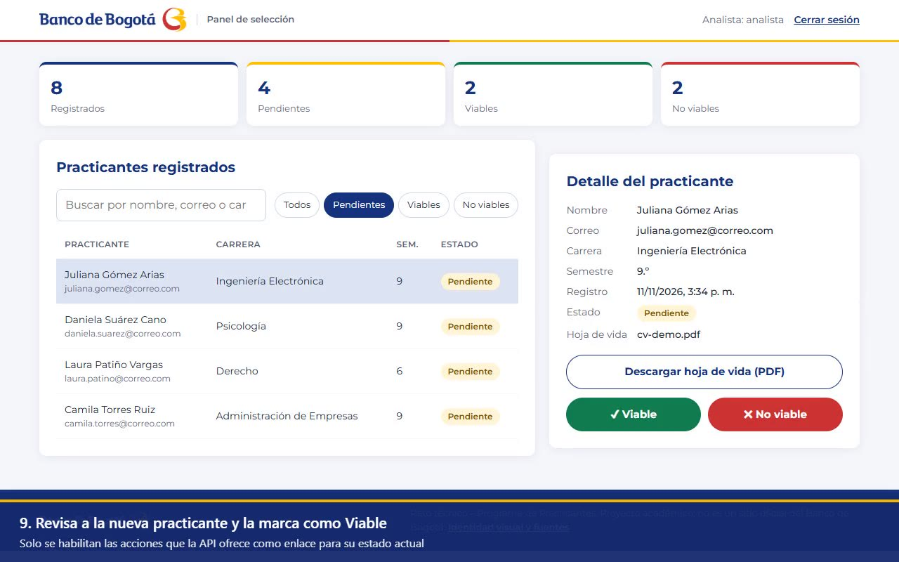](docs/videos/demo-aplicacion.mp4)

#### E3. Formulario de registro y E4. Login

| Registro del practicante | Login del analista |
|---|---|
| 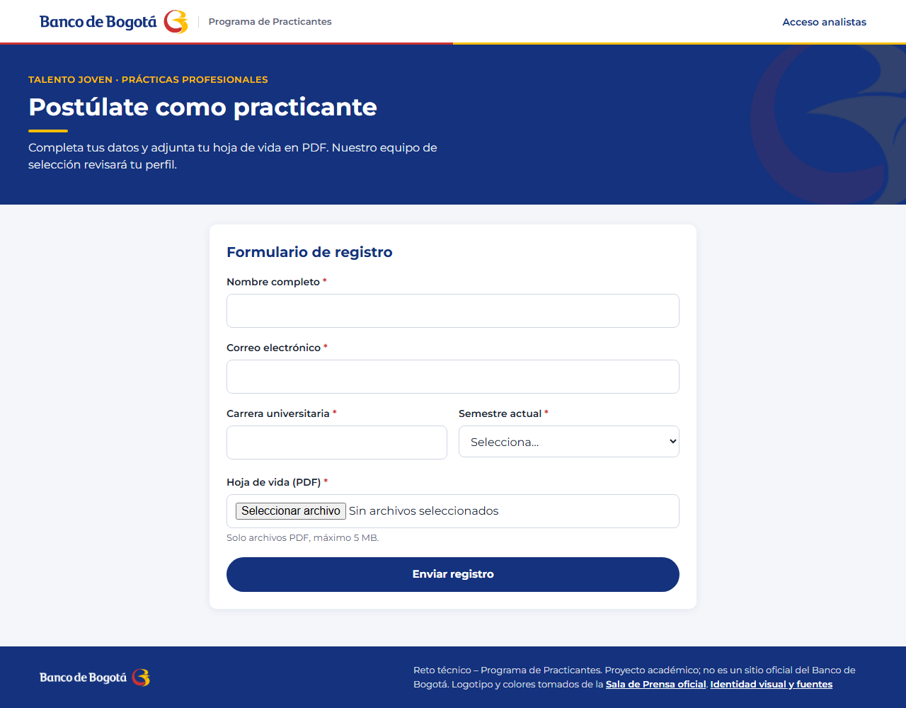 | 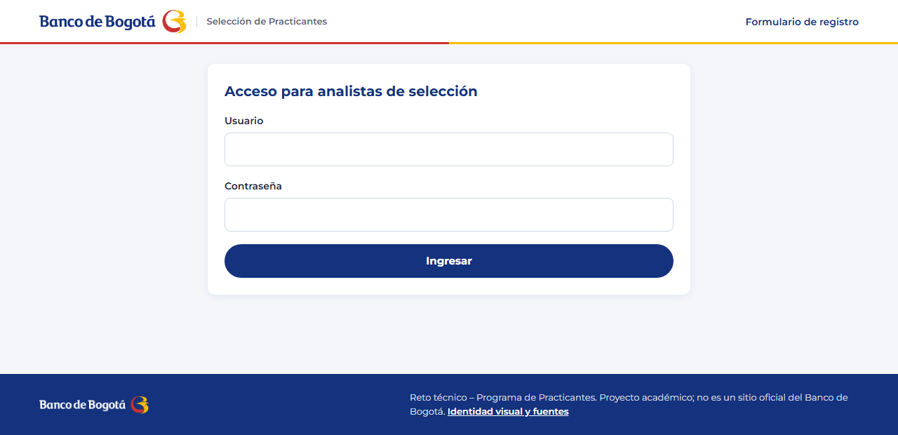 |

#### E5. Panel del analista

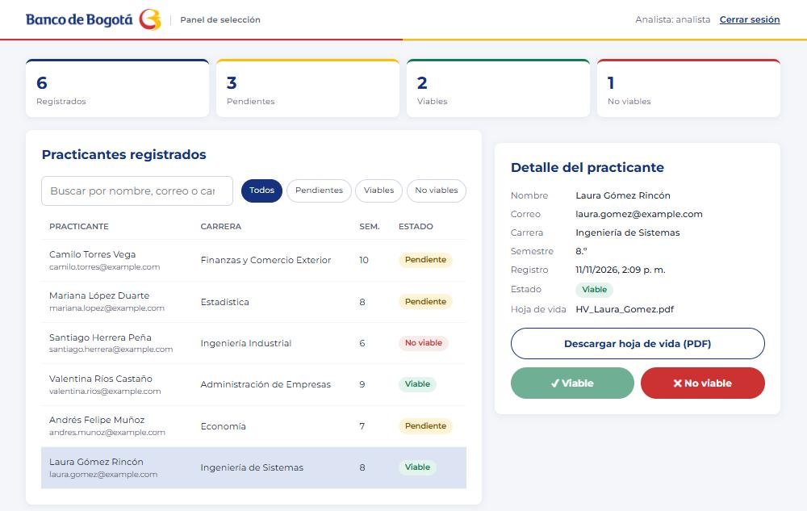

#### E6. Decisión del analista: Viable / No viable

Al pulsar un botón, el panel sigue el enlace `marcar-viable` o `marcar-no-viable` y envía `If-Match`. Después, el botón del estado actual queda deshabilitado porque la API ya no ofrece ese enlace.

| Marcado como **Viable** | Marcado como **No viable** |
|---|---|
| 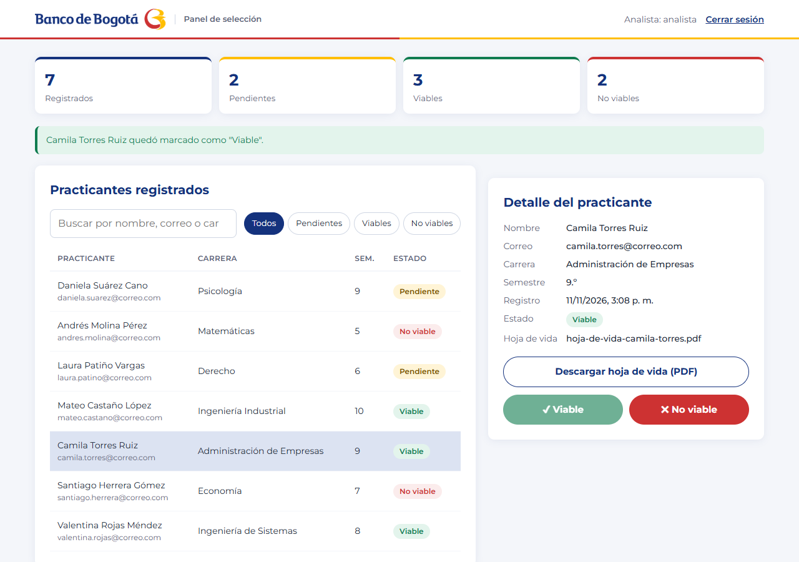 | 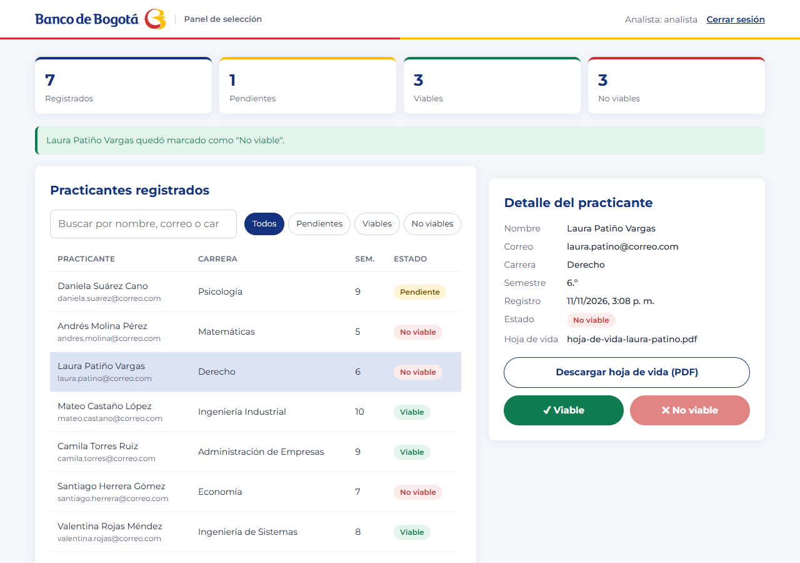 |

### API (back-end)

#### E2. Video: prueba de los endpoints en Swagger UI

Duración: 2 min 27 s, sin audio. Recorrido:

1. `GET /api`.
2. Token CSRF y **Authorize**.
3. Login.
4. Lista paginada en HAL.
5. Detalle con `ETag`.
6. `PATCH` con `If-Match`: `200`, luego `412` y `409`.
7. Registro con semestre 11 (`400`) y con semestre 10 (`201`).

[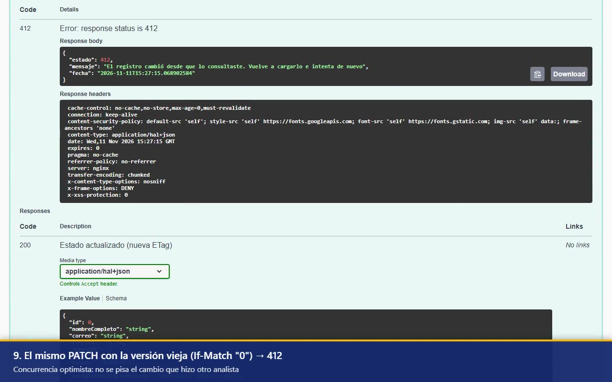](docs/videos/demo-endpoints.mp4)

#### E7. Swagger UI

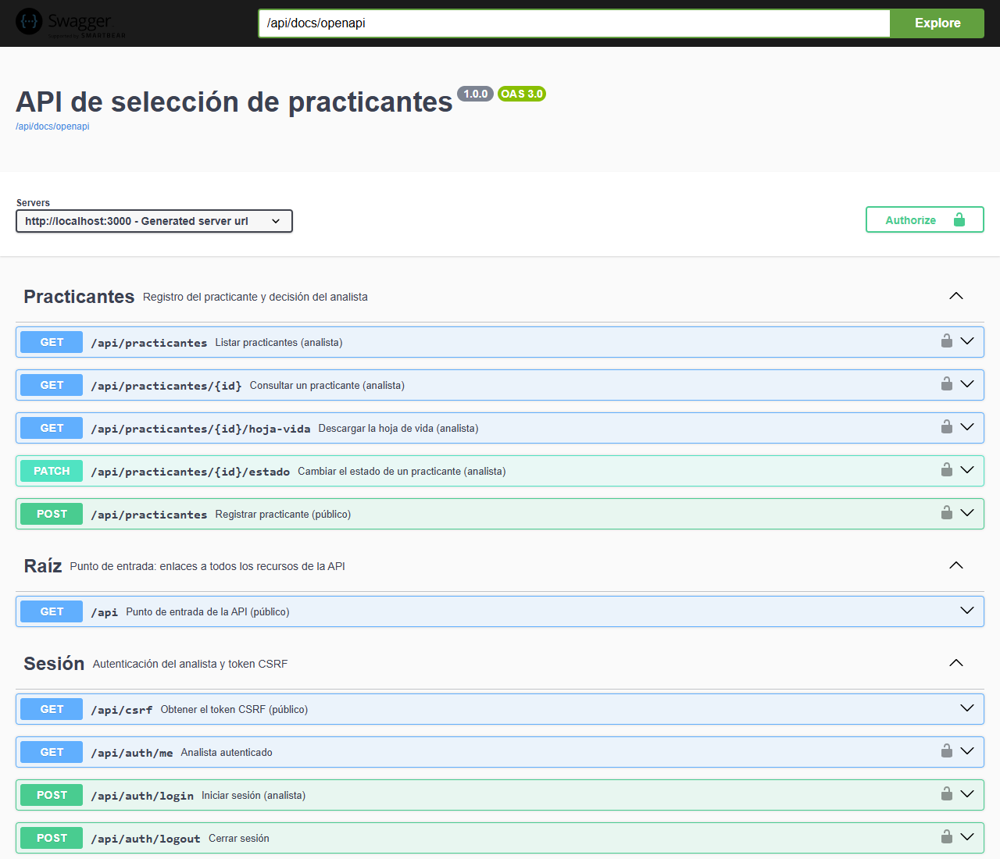

### Calidad

Cada insignia del encabezado tiene su captura de respaldo:

| Insignia | Qué mide | Valor | Evidencia |
|---|---|---|---|
|  | Que el workflow de CI (pruebas, cobertura y análisis) termine bien | Passing | [Evidencia E8](#e8-github-actions) |
|  | Que el código cumpla el umbral de calidad de SonarCloud | Passed | [Evidencia E9](#e9-sonarcloud), recuadro "Quality gate" |
|  | Porcentaje de código ejecutado por las pruebas | 98,4 % en SonarCloud (líneas) y 99 % en JaCoCo (instrucciones) | [Evidencia E9](#e9-sonarcloud), recuadro "Coverage", y [Evidencia E10](#e10-jacoco) |
|  | Errores de código detectados por el análisis estático | 0 | [Evidencia E9](#e9-sonarcloud), recuadro "Reliability" (0 incidencias) |

#### E8. GitHub Actions

Ejecuciones del workflow "Pruebas y SonarCloud" en `main`, todas en verde. Cada ejecución corre `mvn verify` (98 pruebas y cobertura mínima del 90 %) y envía el análisis a SonarCloud. [Ver en GitHub](https://github.com/AnaFiquitiva/kata-practicing/actions).

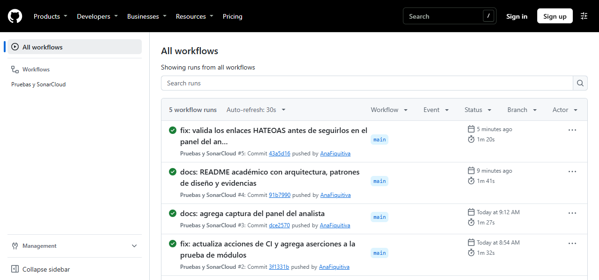

#### E9. SonarCloud

Quality Gate **Passed**. Security, Reliability (bugs) y Maintainability con **0 incidencias** y calificación **A**, cobertura del **98,4 %** y **0 %** de duplicación, analizando el commit `43a5d16`. [Ver en SonarCloud](https://sonarcloud.io/summary/overall?id=AnaFiquitiva_kata-practicing).

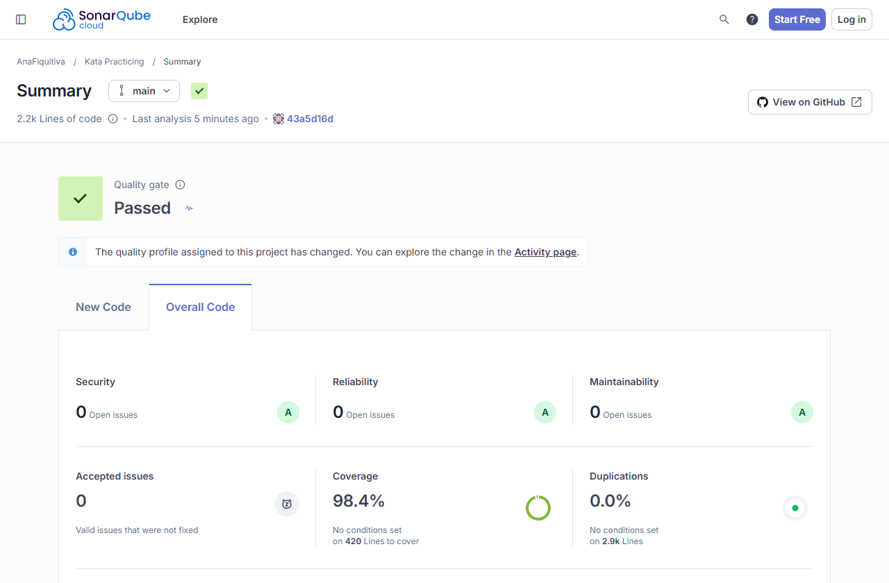

#### E10. JaCoCo

Reporte local generado con `mvn verify` en `backend/target/site/jacoco/index.html`: **99 %** de instrucciones y **96 %** de ramas cubiertas, por encima del mínimo del 90 % que exige el build.

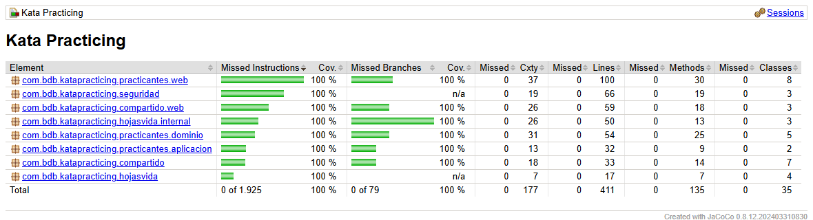

> SonarCloud y GitHub Actions muestran el último *push* a `main`. JaCoCo corresponde al código local.

### Marca

#### E11. Identidad visual

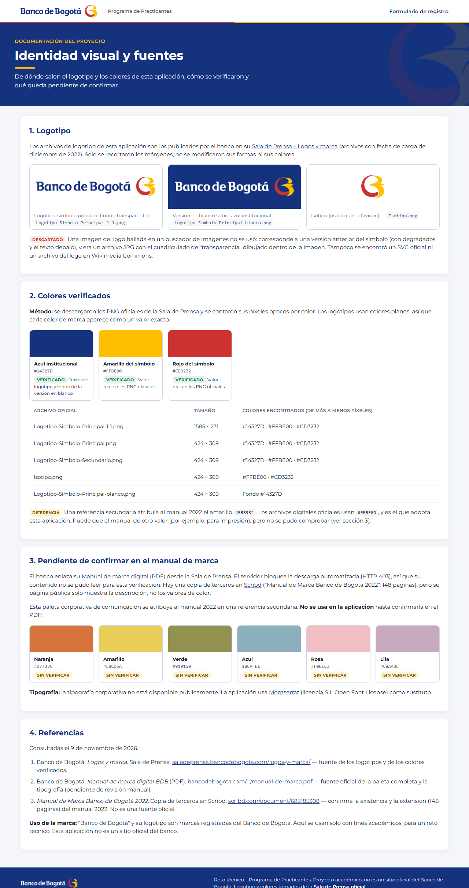

> GitHub no reproduce dentro del README un MP4 guardado en el repositorio: al hacer clic en la miniatura se abre la vista del archivo, desde donde se puede ver o descargar.

---

## 10. Instalación y ejecución

### Requisitos

- **Docker Desktop** (o Docker Engine + Compose v2).
- Solo para ejecutar sin Docker o correr las pruebas: **JDK 21** y **Maven 3.9+**.

### Con Docker (recomendado)

```bash
docker compose up --build -d
```

| Aplicación | URL |
|---|---|
| Formulario del practicante | http://localhost:3000 |
| Panel del analista | http://localhost:3000/analista.html |
| Swagger UI | http://localhost:3000/api/docs/swagger-ui.html |
| Raíz de la API (HATEOAS) | http://localhost:3000/api |
| Health check | http://localhost:8080/actuator/health |

**Credenciales del analista:** usuario `analista`, contraseña `Bogota2026*`

```bash
docker compose down              # detener (los datos se conservan)
docker compose logs -f           # ver logs
docker compose up --build -d     # reconstruir tras cambios en el back-end
```

**Variables opcionales** (por ejemplo, si los puertos están ocupados):

```powershell
$env:FRONTEND_PORT="3080"; $env:BACKEND_PORT="18080"; $env:ANALISTA_PASSWORD="OtraClave123"; docker compose up --build -d
```

| Variable | Por defecto |
|---|---|
| `FRONTEND_PORT` | `3000` |
| `BACKEND_PORT` | `8080` |
| `ANALISTA_USUARIO` | `analista` |
| `ANALISTA_PASSWORD` | `Bogota2026*` |

### Persistencia

| Dato | En el contenedor | En tu equipo |
|---|---|---|
| Base de datos SQLite | `/app/data/practicantes.db` | `backend_data/db/practicantes.db` |
| Hojas de vida (PDF) | `/app/uploads/<uuid>.pdf` | `backend_data/uploads/` |

Se usan *bind mounts*: la información sobrevive a `docker compose down`, a reinicios y a reconstrucciones. No borres a mano `backend_data/`.

### Sin Docker (desarrollo del back-end)

```bash
cd backend
mvn spring-boot:run
```

Usa las mismas carpetas `../backend_data/`. Para el front, levanta solo Nginx apuntando al back-end local:

```powershell
docker run --rm -p 3000:80 -e BACKEND_URL=http://host.docker.internal:8080 -e NGINX_ENVSUBST_FILTER=^BACKEND_URL$ `
  -v "${PWD}/frontend:/usr/share/nginx/html:ro" `
  -v "${PWD}/frontend/nginx/default.conf.template:/etc/nginx/templates/default.conf.template:ro" nginx:1.27-alpine
```

---

## 11. Referencia de la API REST

Las respuestas usan HAL (`application/hal+json`) o HAL-FORMS (`application/prs.hal-forms+json`), según la cabecera `Accept`.

| Método | Ruta | Acceso | Descripción |
|---|---|---|---|
| `GET` | `/api` | Público | Punto de entrada: enlaces a todos los recursos |
| `GET` | `/api/csrf` | Público | Token CSRF (`{ token, headerName }`) |
| `POST` | `/api/auth/login` | Público | Inicia sesión (`username`, `password`, formulario urlencoded) → `200` o `401` |
| `POST` | `/api/auth/logout` | Analista | Cierra la sesión → `204` |
| `GET` | `/api/auth/me` | Analista | Usuario autenticado, o `401` |
| `POST` | `/api/practicantes` | Público | Registra un practicante (`multipart/form-data`) → `201` + `Location` + `ETag` |
| `GET` | `/api/practicantes?estado=&page=&size=&sort=` | Analista | Lista paginada con `first`/`prev`/`next`/`last` |
| `GET` | `/api/practicantes/{id}` | Analista | Detalle con `ETag`; `304` con `If-None-Match` |
| `PATCH` | `/api/practicantes/{id}/estado` | Analista | `{"estado": "VIABLE"}` + `If-Match` → `200`, `409` o `412` |
| `GET` | `/api/practicantes/{id}/hoja-vida` | Analista | Descarga el PDF con su nombre original |
| `GET` | `/api/docs/swagger-ui.html`, `/api/docs/openapi` | Público | Swagger UI y contrato OpenAPI 3 |
| `GET` | `/actuator/health` | Público | Estado del servicio (lo usa Docker) |

**Probar desde Swagger UI:**

1. `GET /api/csrf` y copia el `token`.
2. **Authorize** → `csrf` → pega el token.
3. `POST /api/auth/login` con `analista` / `Bogota2026*`.
4. Al iniciar sesión el token cambia: repite los pasos 1 y 2.

---

## 12. Estructura del proyecto

```
kata-practicing/
├── docker-compose.yml                      # Orquesta los dos contenedores
├── sonar-project.properties                # Configuración de SonarCloud
├── .github/workflows/sonarcloud.yml        # CI: pruebas + cobertura + análisis
├── frontend/                               # ── FRONT-END (contenedor Nginx)
│   ├── index.html · login.html · analista.html · marca.html
│   ├── css/styles.css                      # Variables CSS, Grid/Flexbox, responsive
│   ├── js/comun.js                         # Utilidades compartidas (el, CSRF, alertas)
│   ├── js/registro.js · login.js           # Formularios
│   ├── js/analista.js                      # Panel: cliente hipermedia
│   └── nginx/default.conf.template         # Proxy inverso y cabeceras de seguridad
├── backend/                                # ── BACK-END (contenedor Spring Boot)
│   ├── Dockerfile                          # Multi-stage: JDK 21 → JRE 21 Alpine
│   ├── pom.xml
│   └── src/main/java/com/bdb/katapracticing/
│       ├── practicantes/                   # MÓDULO de negocio principal
│       │   ├── web/                        #   Controller, DTO, Assembler HATEOAS, HAL-FORMS
│       │   ├── aplicacion/                 #   PracticanteService (casos de uso)
│       │   ├── dominio/                    #   Practicante, EstadoPracticante, excepciones
│       │   └── persistencia/               #   PracticanteRepository
│       ├── hojasvida/                      # MÓDULO de archivos PDF
│       │   ├── HojasVidaService.java       #   Facade (API pública)
│       │   └── internal/                   #   Validador, nombres, puerto y adaptador (privados)
│       ├── seguridad/                      # MÓDULO de autenticación
│       └── compartido/                     # MÓDULO de contrato común (rutas, errores, ETags)
│           └── web/                        #   Manejador global, raíz /api, OpenAPI
├── backend_data/                           # Volúmenes persistentes (ignorado por git)
└── docs/
    ├── capturas/                           # Evidencias en imagen
    └── videos/                             # Videos de demostración (MP4 + miniatura)
```

---

## 13. Cumplimiento del reto

| Requisito | Estado | Dónde |
|---|---|---|
| Formulario: nombre, correo, carrera, semestre | ✅ | [`index.html`](frontend/index.html), [Evidencia E3](#e3-formulario-de-registro-y-e4-login) |
| Subir hoja de vida (PDF) | ✅ | [`index.html`](frontend/index.html); el servidor valida la firma `%PDF-` |
| Validación de campos obligatorios (JS) | ✅ | [`registro.js`](frontend/js/registro.js), más Jakarta Validation en el servidor |
| Panel: lista, detalle, botones Viable / No viable | ✅ | [`analista.js`](frontend/js/analista.js), [Evidencia E6](#e6-decisión-del-analista-viable--no-viable) |
| API: guardar, listar, actualizar estado | ✅ | [`PracticanteController`](backend/src/main/java/com/bdb/katapracticing/practicantes/web/PracticanteController.java) |
| Base de datos local SQLite | ✅ | `backend_data/db/practicantes.db` |
| Archivos en una carpeta del servidor | ✅ | `backend_data/uploads/` |
| README con instalación, ejecución y capturas | ✅ | Este documento |
| Opcional 1: autenticación básica | ✅ | [`SecurityConfig`](backend/src/main/java/com/bdb/katapracticing/seguridad/SecurityConfig.java#L46) |
| Opcional 2: descarga de la hoja de vida | ✅ | `GET /api/practicantes/{id}/hoja-vida` |
| **Adicional:** monolito modular verificado | ✅ | [Sección 4.2](#42-estilo-arquitectónico-monolito-modular), [`ModulosTest`](backend/src/test/java/com/bdb/katapracticing/ModulosTest.java#L26) |
| **Adicional:** REST nivel 3 + Swagger | ✅ | [Sección 4.4](#44-estilo-de-la-api-rest-nivel-3-hateoas), [Evidencia E2](#e2-video-prueba-de-los-endpoints-en-swagger-ui), [Evidencia E7](#e7-swagger-ui) |
| **Adicional:** integridad y concurrencia | ✅ | [Sección 6](#6-integridad-de-datos) |
| **Adicional:** CI, SonarCloud y cobertura mínima del 90 % | ✅ | [Evidencia E8](#e8-github-actions), [Evidencia E9](#e9-sonarcloud), [Evidencia E10](#e10-jacoco) |

---

## 14. Identidad visual y fuentes

La interfaz usa el logotipo y los colores oficiales del Banco de Bogotá (detalle en `/marca.html`).

- **Logotipos:** descargados de la [Sala de Prensa del Banco de Bogotá – Logos y marca](https://saladeprensa.bancodebogota.com/logos-y-marca/) (archivos de diciembre de 2022); solo se recortaron los márgenes.
- **Colores verificados** contando los píxeles de los PNG oficiales:

| Uso | HEX |
|---|---|
| Azul institucional | `#14327D` |
| Amarillo del símbolo | `#FFBE00` |
| Rojo del símbolo | `#CD3232` |

- **Pendiente de verificar:** una referencia secundaria atribuye al *Manual de Manejo de Marca 2022* otra paleta y un amarillo `#EBB932` que **no** coincide con los archivos oficiales. No se pudo confirmar en el [PDF del manual](https://www.bancodebogota.com/wps/themes/html/banco-de-bogota/pdf/nuestra-organizacion/manual-de-marca.pdf), así que no se usa.
- **Tipografía:** la corporativa no es pública; se usa [Montserrat](https://fonts.google.com/specimen/Montserrat) (SIL OFL) como sustituto.

> "Banco de Bogotá" y su logotipo son marcas registradas del Banco de Bogotá. Se usan solo con fines académicos, para un reto técnico. Esta aplicación no es un sitio oficial del banco.

---

## 15. Referencias

1. Gamma, E., Helm, R., Johnson, R. y Vlissides, J. (1994). *Design Patterns: Elements of Reusable Object-Oriented Software*. Addison-Wesley. (Facade, Adapter, Factory Method, State).
2. Fowler, M. (2002). *Patterns of Enterprise Application Architecture*. Addison-Wesley. (Repository, DTO, Optimistic Offline Lock, Unit of Work).
3. Buschmann, F., Meunier, R., Rohnert, H., Sommerlad, P. y Stal, M. (1996). *Pattern-Oriented Software Architecture, Vol. 1: A System of Patterns*. Wiley. (Arquitectura en capas).
4. Evans, E. (2003). *Domain-Driven Design: Tackling Complexity in the Heart of Software*. Addison-Wesley. (Modelo de dominio rico, Repository).
5. Larman, C. (2004). *Applying UML and Patterns* (3.ª ed.). Prentice Hall. (GRASP: Experto en información, Bajo acoplamiento).
6. Martin, R. C. (2017). *Clean Architecture*. Prentice Hall. (Principios SOLID, inversión de dependencias).
7. Cockburn, A. (2005). [*Hexagonal Architecture (Ports and Adapters)*](https://alistair.cockburn.us/hexagonal-architecture/).
8. Fowler, M. (2010). [*Richardson Maturity Model*](https://martinfowler.com/articles/richardsonMaturityModel.html).
9. Fielding, R. T. (2000). [*Architectural Styles and the Design of Network-based Software Architectures*](https://www.ics.uci.edu/~fielding/pubs/dissertation/top.htm) (tesis doctoral, capítulo 5: REST).
10. IETF. (2022). [*RFC 9110: HTTP Semantics*](https://www.rfc-editor.org/rfc/rfc9110) (secciones 8.8.3 `ETag` y 13.1 peticiones condicionales).
11. Kelly, M. [*JSON Hypertext Application Language (HAL)*](https://datatracker.ietf.org/doc/html/draft-kelly-json-hal), Amundsen, M. [*HAL-FORMS*](https://rwcbook.github.io/hal-forms/).
12. Spring. [*Spring Modulith — Reference Documentation*](https://docs.spring.io/spring-modulith/reference/), [*Spring HATEOAS*](https://docs.spring.io/spring-hateoas/docs/current/reference/html/).
13. OWASP. [*Cross Site Scripting Prevention Cheat Sheet*](https://cheatsheetseries.owasp.org/cheatsheets/Cross_Site_Scripting_Prevention_Cheat_Sheet.html), [*CSRF Prevention Cheat Sheet*](https://cheatsheetseries.owasp.org/cheatsheets/Cross-Site_Request_Forgery_Prevention_Cheat_Sheet.html).
